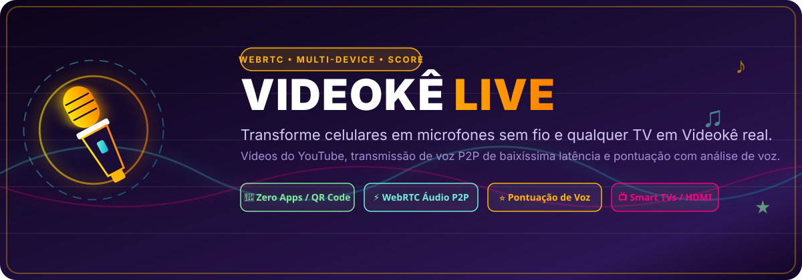
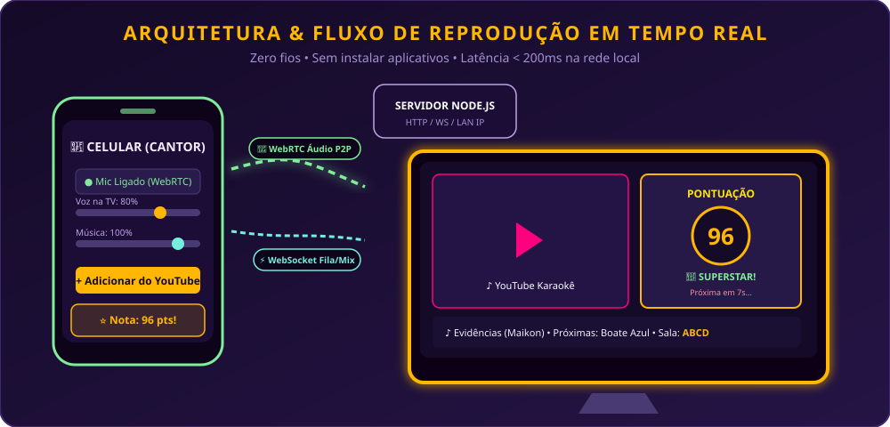

<div align="center">

  

  <br><br>

  <p align="center">
    <strong>Sistema de Karaokê Web em Tempo Real com microfones sem fio nos celulares, backing tracks do YouTube, transmissão de voz via WebRTC e pontuação clássica de Videokê.</strong>
  </p>

  <p align="center">
    <a href="#-recursos-principais">Recursos</a> •
    <a href="#-arquitetura-e-fluxo">Arquitetura</a> •
    <a href="#-como-rodar-localmente">Como Rodar</a> •
    <a href="#-pontuação-videokê-score">Sistema de Pontuação</a> •
    <a href="#-deploy-em-produção">Deploy</a> •
    <a href="#-apoie-o-projeto--support-me">Apoie o Projeto</a>
  </p>

  <p align="center">
    
    
    
    
    
  </p>

  <p align="center">
    <a href="https://github.com/maikonfcosta/videoke-live">
      
    </a>
  </p>

</div>

---

## 💡 Sobre o Projeto

O **Videokê Live** transforma qualquer Smart TV (ou computador ligado à TV via HDMI) em uma central completa de Karaokê/Videokê profissional, eliminando a necessidade de aparelhos caros ou microfones dedicados.

### Como funciona na prática?
1. **A TV abre a tela de palco (`/tv`):** Exibe um código de 4 letras e um QR Code dinâmico na tela.
2. **Os convidados escaneiam o QR Code pelo celular:** Sem instalar nenhum aplicativo, o navegador do celular transforma o smartphone em um **microfone sem fio de baixíssima latência (< 200ms)**.
3. **Fila compartilhada e mixagem:** Qualquer pessoa na sala pode buscar e enfileirar vídeos de karaokê do YouTube, ajustar individualmente o volume de sua voz e da música direto pelo celular.
4. **Videokê Score Oficial:** Ao terminar a canção, a TV analisa o engajamento vocal (tempo cantando, volume e modulação), toca fanfarra sonora e exibe a nota de 0 a 100 com classificação animada na tela!

---

## 💖 Apoie o Projeto / Support Me

Se este projeto te ajudou, animou suas festas de família ou serviu como base para seus estudos de **WebRTC & Áudio em tempo real**, considere fazer uma doação para apoiar o desenvolvimento e manutenção contínua:

<div align="center">

[](https://buymeacoffee.com/maikonfcosta)
[](https://github.com/sponsors/maikonfcosta)

### 🇧🇷 Doações via Pix
Qualquer valor incentiva a manutenção e criação de novos projetos open-source!

**Chave Pix (E-mail):** `maikonfcosta@gmail.com`  
**Nome:** Maikon Felipe Fernandes da Costa

</div>

---

## 📐 Arquitetura e Fluxo

<div align="center">
  
</div>

- **Celulares (Cantores):** Captura de áudio de alta fidelidade sem processamento agressivo via `navigator.mediaDevices.getUserMedia`, mantendo a tela ativa (`Screen Wake Lock`) e transmitindo áudio direto para a TV via WebRTC.
- **TV (Palco & Mixagem):** Executa o player do YouTube via IFrame API (`origin` blindado contra erros 150/153), recebe os múltiplos canais WebRTC e analisa a voz em tempo real usando a `Web Audio API` (`AnalyserNode`).
- **Servidor WebSocket (`server.js`):** Sinalização WebRTC leve, sincronização de estado (`snapshot`), validação de incorporação de vídeos via `oEmbed` e detecção automática do IP da rede local.

---

## ✨ Recursos Principais

- [x] **Zero Instalação:** Não requer app da App Store ou Play Store. Funciona direto no Chrome, Safari, Edge ou Firefox.
- [x] **Áudio WebRTC de Baixa Latência:** A voz sai na TV junto com o playback em tempo real.
- [x] **Compatibilidade com Smart TVs:** Interface `/tv` em JavaScript puro (ES5) para rodar fluidamente no Fire TV Stick (Silk), Google TV, Android TV ou notebook via HDMI.
- [x] **Prevenção de Queda por Tela Apagada:** Reconquista automática da trava de tela (`Screen Wake Lock`) ao alternar abas ou voltar do app do YouTube.
- [x] **Controle de Mix Individual e Global:** Sliders na tela do celular para ajustar o ganho da própria voz e o volume geral da música na TV.
- [x] **Fila Democrática:** Qualquer cantor na sala pode pesquisar por link/ID do YouTube e adicionar à fila com avanço automático.
- [x] **Validação Segura de Embed:** Vídeos bloqueados para incorporação externa são detectados antes de travar a TV.

---

## 🏆 Pontuação Videokê Score

Ao final de cada música, o sistema calcula uma nota oficial de **0 a 100** analisando amostras colhidas em tempo real:

| Faixa de Pontuação | Classificação | Efeito / Mensagem |
| :---: | :---: | :--- |
| **95 – 100** | 🌟 **SUPERSTAR!** | Show impecável! O palco é seu! |
| **88 – 94** | 🎤 **MANDOU MUITO BEM!** | Afinadíssimo! A galera vibrou junto! |
| **78 – 87** | 🎶 **BOA APRESENTAÇÃO!** | Cheio de ritmo e energia! Muito bom! |
| **50 – 77** | 🚿 **VALEU A CORAGEM!** | Mais um ensaio no chuveiro e fica perfeito! |

- **Feedback sonoro:** Acordes triunfais sintetizados via Web Audio.
- **Feedback tátil no celular:** Vibração rítmica (`navigator.vibrate`) e card de comemoração com a nota recebida.
- **Transição suave:** Contagem regressiva de 7 segundos antes de puxar a próxima música da fila.

---

## 🚀 Como Rodar Localmente

### Pré-requisitos
- **Node.js** >= 18.0.0 instalado ([nodejs.org](https://nodejs.org))

### 1. Clonar o Repositório e Instalar Dependências
```bash
git clone https://github.com/maikonfcosta/videoke-live.git
cd videoke-live
npm install
```

### 2. Executar os Testes Automatizados
```bash
npm test
```
*Executa a suíte de 11 testes cobrindo HTTP, WebRTC, Fila, Snapshot e Pontuação via Node Test Runner nativo.*

### 3. Iniciar o Servidor
```bash
npm start
```

O console exibirá:
```text
TV: http://localhost:3000/tv
Rede local: http://192.168.15.9:3000/tv
```

---

## 📱 Dica de Ouro: Como Usar o Microfone no Celular

Por normas de segurança internacionais dos navegadores (**W3C Secure Contexts**), a API de microfone só é liberada em conexões seguras (**HTTPS**) ou em `localhost`.

### Opção A (Recomendada — Túnel HTTPS Instantâneo Gratuito):
Para usar em festas na sua casa sem configurar certificados, suba um túnel temporário:
```bash
npx localtunnel --port 3000
```
Abra a URL HTTPS gerada na TV (`https://sua-url.loca.lt/tv`) e escaneie o QR Code com o celular!

### Opção B (Uso 100% Offline em Wi-Fi no Chrome do Android):
1. No Chrome do celular, acesse `chrome://flags/#unsafely-treat-insecure-origin-as-secure`
2. Adicione o IP da sua máquina (ex: `http://192.168.15.9:3000`)
3. Reinicie o Chrome. O microfone funcionará localmente sem internet!

---

## 🌐 Deploy em Produção

O **Videokê Live** foi projetado para rodar perfeitamente em serviços de hospedagem com suporte a WebSockets e HTTPS automático:

### Deploy no Render / Railway / Fly.io:
- **Build Command:** `npm install`
- **Start Command:** `npm start`
- **Port:** `process.env.PORT || 3000`

---

## 🧪 Estrutura do Projeto

```text
videoke-live/
├── public/
│   ├── assets/
│   │   ├── banner.svg       # Banner de alta resolução para o README
│   │   ├── logo.svg         # Logotipo vetorial oficial
│   │   ├── favicon.svg      # Ícone do navegador
│   │   └── flow-demo.svg    # Diagrama de arquitetura WebRTC
│   ├── index.html           # Landing Page principal com CTAs e apresentação
│   ├── sing.html            # Interface do celular (microfone e fila)
│   └── tv.html              # Interface da TV (player, áudio e pontuação)
├── test/
│   └── karaoke.test.js      # Suíte com 12 testes automatizados (Node Test Runner)
├── .gitignore
├── LICENSE                  # Licença MIT
├── package.json
├── server.js                # Servidor HTTP + WebSocket nativo
└── SPEC.md                  # Especificação técnica formal e critérios de aceite
```

---

## 📄 Licença

Distribuído sob a licença **MIT**. Consulte o arquivo [`LICENSE`](LICENSE) para obter mais informações.

---

<div align="center">
  Desenvolvido com 💜 por <a href="https://github.com/maikonfcosta"><strong>Maikon Costa</strong></a>
</div>
