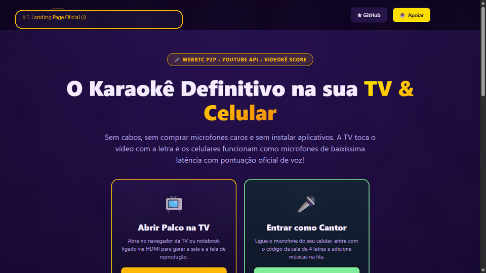

<div align="center">

  

  <br><br>

  <p align="center">
    <strong>Sistema de Karaokê Web em Tempo Real com microfones sem fio nos celulares, backing tracks do YouTube, transmissão de voz via WebRTC e pontuação clássica de Videokê.</strong>
  </p>

  <p align="center">
    <a href="#-demonstração-em-ação">Demonstração</a> •
    <a href="#-recursos-principais">Recursos</a> •
    <a href="#-arquitetura-e-conectividade-global">Arquitetura</a> •
    <a href="#-como-rodar-localmente">Como Rodar</a> •
    <a href="#-deploy-em-produção-online-247">Deploy Online</a> •
    <a href="#-pontuação-videokê-score">Pontuação</a> •
    <a href="#-apoie-o-projeto--support-me">Apoie o Projeto</a>
  </p>

  <p align="center">
    
    
    
    
    
    
  </p>

  <p align="center">
    <a href="https://github.com/maikonfcosta/videoke-live">
      
    </a>
  </p>

</div>

---

## 🎬 Demonstração em Ação

Confira a jornada completa do usuário: entrada pela **Landing Page**, abertura do **Palco na TV** com QR Code universal, conexão do **Smartphone do Cantor** via microfone sem fio, envio de músicas do YouTube para a fila e reprodução ao vivo na TV com o **Badge Flutuante de QR Code no topo**:

<div align="center">
  
</div>

---

## 💡 Sobre o Projeto

O **Videokê Live** transforma qualquer Smart TV (ou computador ligado à TV via HDMI) em uma central completa de Karaokê/Videokê profissional, eliminando a necessidade de aparelhos caros ou microfones dedicados.

### Como funciona a jornada?
1. **Landing Page Inicial (`/`):** Portal de boas-vindas com apresentação, botões diretos para o modo TV ou microfone e instruções rápidas.
2. **Palco na TV (`/tv`):** Exibe um código de 4 letras e um **QR Code universal dinâmico** gerado instantaneamente em 0ms (*Zero-Delay*), com suporte a 100% dos navegadores de Smart TV.
3. **Microfone no Celular (`/sing`):** O cantor escaneia o QR Code e digita seu nome. Sem instalar apps, o navegador do celular transforma o smartphone em um **microfone sem fio de baixíssima latência (< 200ms)**.
4. **Fila Compartilhada & Mixagem:** Qualquer pessoa na sala pode buscar e enfileirar vídeos do YouTube, ajustando individualmente o volume de sua própria voz e da música na TV.
5. **Badge Flutuante no Canto da TV (`#qr-corner`):** Durante a execução do vídeo no YouTube, uma miniatura do QR Code e o código da sala permanecem discretamente no canto superior direito para que novos convidados possam entrar a qualquer momento da festa sem interromper o show.
6. **Videokê Score Oficial:** Ao terminar a canção, a TV analisa o engajamento vocal (tempo cantando, volume e modulação), toca fanfarra sonora e exibe a nota de 0 a 100 com classificação animada na tela!

---

## 💖 Apoie o Projeto / Support Me

Se este projeto te ajudou, animou suas festas de família ou serviu como base para seus estudos de **WebRTC & Áudio em tempo real**, considere fazer uma doação para apoiar o desenvolvimento e manutenção contínua:

<div align="center">

[](https://buymeacoffee.com/maikonfcosta)
[](https://github.com/sponsors/maikonfcosta)

### 🇧🇷 Doações via Pix
Qualquer valor incentiva a manutenção e criação de novos projetos open-source!

**Chave Pix (E-mail):** `maikonfcosta@gmail.com`  
**Nome:** Maikon Felipe Fernandes da Costa

</div>

---

## 📐 Arquitetura e Conectividade Global

<div align="center">
  
</div>

- **Celulares (Cantores):** Captura de áudio de alta fidelidade sem processamento agressivo via `navigator.mediaDevices.getUserMedia`, mantendo a tela ativa (`Screen Wake Lock`) e transmitindo áudio direto para a TV via WebRTC.
- **TV (Palco & Mixagem):** Executa o player do YouTube via IFrame API (`origin` blindado contra erros 150/153), recebe os múltiplos canais WebRTC e analisa a voz em tempo real usando a `Web Audio API` (`AnalyserNode`).
- **Travessia de NAT (Multi-STUN Pool):** Configuração com múltiplos servidores STUN globais redundantes (**Google STUN** e **Cloudflare STUN** `stun.cloudflare.com:3478`), permitindo que celulares em redes móveis (4G/5G Claro, Vivo, TIM) conectem diretamente a voz à Smart TV em redes Wi-Fi residenciais (com CGNAT) sem bloqueios de firewall.
- **Servidor WebSocket (`server.js`):** Sinalização WebRTC leve, sincronização de estado (`snapshot`), validação de incorporação de vídeos via `oEmbed` e detecção automática do IP da rede local.

---

## ✨ Recursos Principais

- [x] **Zero Instalação:** Não requer app da App Store ou Play Store. Funciona direto no Chrome, Safari, Edge ou Firefox.
- [x] **Áudio WebRTC de Baixa Latência:** A voz sai na TV junto com o playback em tempo real.
- [x] **QR Code Universal Imune a Falhas de Smart TVs:** Renderizado como tag nativa `` em Data URI (`data:image/gif;base64,...`), garantindo leitura e contraste perfeito mesmo em navegadores legados (Samsung Tizen, LG webOS, Fire TV Silk).
- [x] **Zero-Delay na TV:** A sala é gerada instantaneamente no carregamento da tela da TV (0ms), exibindo o QR Code sem travar em telas de carregamento.
- [x] **Badge Flutuante Persistente (`#qr-corner`):** O QR Code permanece visível em miniatura no canto superior da TV enquanto a música toca, permitindo que novos participantes entrem a qualquer momento.
- [x] **Prevenção de Queda por Tela Apagada:** Reconquista automática da trava de tela (`Screen Wake Lock`) ao alternar abas ou voltar do app do YouTube.
- [x] **Controle de Mix Individual e Global:** Sliders na tela do celular para ajustar o ganho da própria voz e o volume geral da música na TV.
- [x] **Fila Democrática:** Qualquer cantor na sala pode pesquisar por link/ID do YouTube e adicionar à fila com avanço automático.
- [x] **Validação Segura de Embed:** Vídeos bloqueados para incorporação externa são detectados antes de travar a TV.

---

## 🏆 Pontuação Videokê Score

Ao final de cada música, o sistema calcula uma nota oficial de **0 a 100** analisando amostras colhidas em tempo real:

| Faixa de Pontuação | Classificação | Efeito / Mensagem |
| :---: | :---: | :--- |
| **95 – 100** | 🌟 **SUPERSTAR!** | Show impecável! O palco é seu! |
| **88 – 94** | 🎤 **MANDOU MUITO BEM!** | Afinadíssimo! A galera vibrou junto! |
| **78 – 87** | 🎶 **BOA APRESENTAÇÃO!** | Cheio de ritmo e energia! Muito bom! |
| **50 – 77** | 🚿 **VALEU A CORAGEM!** | Mais um ensaio no chuveiro e fica perfeito! |

- **Feedback sonoro:** Acordes triunfais sintetizados via Web Audio.
- **Feedback tátil no celular:** Vibração rítmica (`navigator.vibrate`) e card de comemoração com a nota recebida.
- **Transição suave:** Contagem regressiva de 7 segundos antes de puxar a próxima música da fila.

---

## 🚀 Como Rodar Localmente

### Pré-requisitos
- **Node.js** >= 18.0.0 instalado ([nodejs.org](https://nodejs.org))

### 1. Clonar o Repositório e Instalar Dependências
```bash
git clone https://github.com/maikonfcosta/videoke-live.git
cd videoke-live
npm install
```

### 2. Executar os Testes Automatizados
```bash
npm test
```
*Executa a suíte de 12 testes cobrindo HTTP, WebRTC, Multi-STUN, Fila, Snapshot e Pontuação via Node Test Runner nativo.*

### 3. Iniciar o Servidor
```bash
npm start
```

O console exibirá:
```text
TV: http://localhost:3000/tv
Rede local: http://192.168.1.15:3000/tv
```

---

## 📱 Dica de Ouro: Como Usar o Microfone no Celular

Por normas de segurança internacionais dos navegadores (**W3C Secure Contexts**), a API de microfone só é liberada em conexões seguras (**HTTPS**) ou em `localhost`.

### Opção A (Recomendada — Túnel HTTPS Instantâneo Gratuito):
Para usar em festas na sua casa sem configurar certificados, suba um túnel temporário:
```bash
npx localtunnel --port 3000
```
Abra a URL HTTPS gerada na TV (`https://sua-url.loca.lt/tv`) e escaneie o QR Code com o celular!

### Opção B (Uso 100% Offline em Wi-Fi no Chrome do Android):
1. No Chrome do celular, acesse `chrome://flags/#unsafely-treat-insecure-origin-as-secure`
2. Adicione o IP da sua máquina (ex: `http://192.168.1.15:3000`)
3. Reinicie o Chrome. O microfone funcionará localmente sem internet!

---

## 🌐 Deploy em Produção Online 24/7

O **Videokê Live** suporta uma arquitetura híbrida para funcionar online permanentemente sem custos:

### 1. Frontend na Vercel
A interface estática (`/`, `/tv`, `/sing`) está hospedada na Vercel com carregamento instantâneo via CDN global:
- **URL Oficial:** [https://karaoke-opal-one.vercel.app](https://karaoke-opal-one.vercel.app)

### 2. Backend WebSocket no Render (1-Clique Gratuito)
Para gerenciar a fila e a sinalização WebRTC em tempo real 24/7 sem precisar de computador ligado:
1. Acesse **[dashboard.render.com](https://dashboard.render.com)**.
2. Crie um novo **Web Service** apontando para o repositório público `maikonfcosta/videoke-live`.
3. O arquivo [`render.yaml`](render.yaml) pré-configura a inicialização com plano Free (`npm start`).
4. A TV e os celulares se conectam automaticamente ao backend da nuvem `wss://videoke-live.onrender.com/ws`.

> 💡 **Dica Anti-Hibernação (Zero Cold Start):** Para evitar que o plano gratuito do Render entre em modo de suspensão após 15 minutos de inatividade, cadastre a URL `https://videoke-live.onrender.com` no serviço gratuito **[UptimeRobot](https://uptimerobot.com)** com ping a cada 10 minutos. Seu karaokê ficará 100% acordado e responderá em 0s a qualquer hora do dia!

---

## 🧪 Estrutura do Projeto

```text
videoke-live/
├── public/
│   ├── assets/
│   │   ├── banner.svg       # Banner oficial do projeto
│   │   ├── demo.gif         # Demonstração animada da experiência completa
│   │   ├── logo.svg         # Logotipo vetorial oficial
│   │   ├── favicon.svg      # Ícone do navegador
│   │   └── flow-demo.svg    # Diagrama de arquitetura WebRTC
│   ├── index.html           # Landing Page principal com CTAs e apresentação
│   ├── sing.html            # Interface do celular (microfone sem fio e fila)
│   └── tv.html              # Interface da TV (palco, áudio e pontuação)
├── test/
│   └── karaoke.test.js      # Suíte com 12 testes automatizados (Node Test Runner)
├── .gitignore
├── LICENSE                  # Licença MIT
├── package.json
├── render.yaml              # Blueprint de deploy gratuito no Render
├── server.js                # Servidor HTTP + WebSocket nativo
└── SPEC.md                  # Especificação técnica formal e critérios de aceite
```

---

## 📄 Licença

Distribuído sob a licença **MIT**. Consulte o arquivo [`LICENSE`](LICENSE) para obter mais informações.

---

<div align="center">
  Desenvolvido com 💜 por <a href="https://github.com/maikonfcosta"><strong>Maikon Costa</strong></a>
</div>
